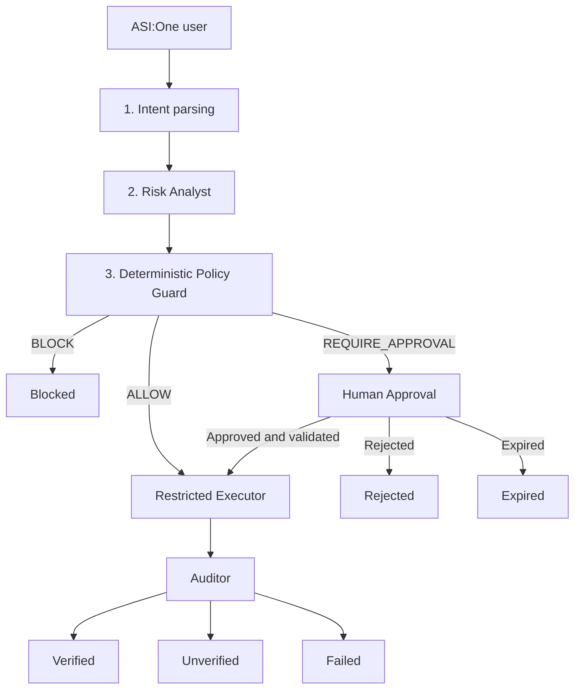

# 🛡️ WARDEN Sentinel Network

<div align="center">

### The model proposes. WARDEN checks it, runs it, and verifies what actually happened.

**A security-control layer for AI-agent file actions, accessible through ASI:One.**

WARDEN routes proposed file operations through intent parsing, risk analysis, deterministic policy enforcement, digest-bound human approval, restricted execution, and outcome auditing.

[](LICENSE)
[](pyproject.toml)
[](tests/)
[](https://fetch.ai)
[](https://fetch.ai)
[](docs/INTERACTIVE_CARDS.md)

**Built for Fetch-A-Thon 3.0 · ASI:One Agent Challenge: From Intent to Action**

[Problem](#-the-problem) · [Architecture](#-the-pipeline) · [Quick Start](#-quick-start) · [Live Demo](#-live-asione-demo) · [Security](#-security-model) · [Hosting](#-deployment-and-hosting) · [Testing](#-testing) · [Documentation](#-documentation)

</div>

---

## 💥 The problem

AI agents increasingly interact with files, configuration, APIs, and development environments. When a model can propose an operation and directly execute it, a mistaken or manipulated instruction can cause real side effects.

Consider three failure scenarios:

- **Prompt injection:** instructions hidden in a file tell an agent to delete a protected configuration file.
- **Forged authority:** a model claims that an administrator authorized an operation, even though no trusted authorization exists.
- **False success:** an agent reports that an operation succeeded when it failed, was blocked, or produced an unexpected result.

An instruction to an AI agent is not a security policy. A model's confidence is not authorization. A success message is not evidence.

## 🛡️ The solution

WARDEN treats an AI model as an **untrusted proposal engine**. The model can suggest actions, but authorization is enforced by deterministic policy code.

The control flow is:

1. Interpret the requested operation.
2. Assess its potential risk.
3. Apply deterministic policy rules.
4. Request human approval when required.
5. Execute only the authorized operation within the restricted workspace.
6. Inspect the resulting state and report the verified outcome.

> **Core security principle:** the model's response and risk assessment do not grant execution authority. A policy decision, valid authorization, restricted execution, and outcome verification are separate steps.

WARDEN is a hackathon prototype, not a production-certified security boundary. Its limitations are documented in [Security Limitations](#-security-limitations).

---

## 🔗 The pipeline



| Stage | Responsibility | Authority |
|---|---|---|
| Intent parsing | Converts a natural-language request into a validated action proposal | No execution authority |
| Risk Analyst | Assesses destructive impact, sensitive targets, traversal, ambiguity, and other risk indicators | Advisory only |
| Policy Guard | Applies deterministic rules to decide whether an operation is allowed, blocked, or requires approval | Authoritative policy decision |
| Approval handler | Validates the sender, action ID, digest, expiry, and applicable approval rules | Records an authorized human decision |
| Restricted Executor | Executes the permitted operation in the configured workspace after authorization checks | Token-gated execution |
| Auditor | Checks the actual result against expected state and available snapshots | Reports outcome evidence |

The supported file operations are `READ`, `CREATE`, `WRITE`, `DELETE`, and `RENAME`, subject to policy and configuration.

### Outcome statuses

WARDEN distinguishes among:

- `VERIFIED` — the operation's outcome passed the configured verification checks.
- `UNVERIFIED` — sufficient verification could not be established.
- `FAILED` — execution or a required stage failed.
- `BLOCKED` — policy denied the operation before execution.
- `AWAITING_APPROVAL` — the operation is pending a valid approval decision.
- `REJECTED` — the request or approval was rejected.
- `EXPIRED` — the approval window elapsed without an accepted decision.

Each response includes a workflow trace and an audit reference when available. A pending operation must not be described as executed.

---

## 🚀 Quick Start

### Requirements

- Python 3.10 or later; Python 3.12 is recommended.
- Git.
- PowerShell on Windows.

Local setup and the synthetic security demo are designed to run without API credentials.

### Windows

```powershell
git clone https://github.com/Zynx095/WARDEN.git
cd WARDEN

powershell -ExecutionPolicy Bypass -File .\scripts\setup.ps1

.\scripts\demo.ps1

.\scripts\run.ps1
```

The setup script prepares the virtual environment, installs dependencies, creates configuration when needed, initializes a local identity if required, and runs diagnostics and tests.

It is designed not to overwrite an existing `.env` or identity.

### Linux / macOS

The following is the documented setup path; the supplied project notes report that the full suite has been run on Windows, so other operating systems should be validated independently.

```bash
python3 -m venv .venv
source .venv/bin/activate

python -m pip install -e ".[dev]"

cp .env.example .env
python -m warden.identity init

python -m pytest
python demo/run_demo.py
python -m warden.doctor
python -m warden.agents.run_agent
```

Add the optional Fetch integration dependencies if you intend to use ASI:One LLM-based intent parsing.

### Useful scripts

| Command | Purpose |
|---|---|
| `.\scripts\setup.ps1` | Environment setup and initial diagnostics |
| `.\scripts\doctor.ps1` | Configuration, identity, workspace, state, audit, and integration checks |
| `.\scripts\test.ps1` | Compilation and pytest |
| `.\scripts\demo.ps1` | Offline synthetic security demonstration |
| `.\scripts\run.ps1` | Starts the local agent |
| `.\scripts\mailbox.ps1 status` | Checks local mailbox and Agentverse connectivity status |
| `.\scripts\mailbox.ps1 connect -Confirm` | Requests mailbox provisioning using the configured Agentverse credentials |

Use `-SkipTests` or `-NoOptional` with setup when appropriate. Consult each script's help or the development documentation before using additional flags.

---

## 🎬 Live ASI:One Demo

**WARDEN has been exercised through a live ASI:One conversation.** The observed workflow demonstrates real agent responses and interactive approval-card presentation, rather than relying exclusively on a local screenshot or offline preview.

### Demonstrated scenarios

#### 1. Create a file

Request:

> Create a new file named `confusedtest.txt`.

Observed result:

- WARDEN returned `VERIFIED`.
- The Auditor reported that the file existed with the expected content.
- The response included the operation, risk advisory, workflow trace, output, and audit reference.
- An ASI:One result card was displayed.

#### 2. Protect a sensitive file

Request:

> Read the protected file `production.env`.

Observed result:

- WARDEN returned `BLOCKED`.
- Policy `WDN-003` was reported.
- The response stated that execution was prevented.
- The protected file operation was denied through the live agent interaction.

#### 3. Require approval for a destructive operation

Request:

> Delete the file named `confusedtest.txt`.

Observed result:

- WARDEN presented an `AWAITING APPROVAL` response.
- An interactive approval card displayed **Approve** and **Reject** controls.
- The card exposed action details, the governing policy, risk advisory, expiry, action ID, and action digest.
- The text response included the corresponding approval instructions.

The approval workflow has also been exercised during live testing. This does not establish that every possible card-click, unauthorized-sender, expired-approval, and replay scenario has been tested against the hosted service; those cases remain part of the regression checklist.

### Interactive Cards

WARDEN implements ASI:One Interactive Cards for approval requests and operation results.

The card is a presentation and interaction mechanism, **not an independent authorization mechanism**. An approval must still pass through the same validation and decision path as a typed approval command.

The intended approval flow is:

1. WARDEN creates a pending action.
2. The approval card presents the action and decision controls.
3. An approval or rejection is submitted.
4. The backend validates the decision against the stored pending action and applicable authorization rules.
5. If approved, execution proceeds through the restricted executor.
6. The outcome is audited and reported.

Card schemas, implementation details, and offline preview instructions are documented in [Interactive Cards](docs/INTERACTIVE_CARDS.md) and [Chat Experience](docs/CHAT_EXPERIENCE.md).

Preview the response formats locally:

```powershell
.\.venv\Scripts\python.exe demo\preview_chat.py --cards
```

An offline preview validates presentation output, not live ASI:One rendering or button delivery.

---

## 🔐 Security Model

### Deterministic policy rules

| Policy | Decision | Rule |
|---|---|---|
| `WDN-000` | Allow | Operations that pass validation and have no rule requiring denial or approval |
| `WDN-001` | Block | Unsupported operations or invalid operation parameters, including a rename without a destination |
| `WDN-002` | Block | Invalid paths or paths outside the configured workspace |
| `WDN-003` | Block | Protected resources, including configured secret and environment files |
| `WDN-004` | Require approval | Destructive `DELETE` and `RENAME` operations |
| `WDN-005` | Approval or block | Overwriting existing files requires approval; renaming onto an existing file is blocked |
| `WDN-006` | Require approval | When required risk assessment is unavailable or invalid |

The exact outcome also depends on input validation, current target state, and applicable configuration. The table summarizes the documented policy behavior.

The model's explanation, requested justification, and risk recommendation cannot grant an exception to a deterministic policy.

### Approval security

Approval decisions are checked against the stored pending action. The documented controls include:

- **Sender authorization:** the decision must come from a permitted sender under the configured approval mode.
- **Digest binding:** the decision must identify the exact proposed action and its canonical digest.
- **Expiry:** the decision must arrive within the configured approval window.
- **Target-state validation:** execution rechecks the relevant target state.
- **Single use:** an action cannot be authorized repeatedly after its decision has been consumed.
- **Persistence:** pending and resolved decisions can be stored in the configured state database.

`WARDEN_APPROVAL_MODE=independent` is intended for deployments where an approver must be different from the requester. The hosted configuration must be reviewed to ensure that the configured approvers and approval mode match the intended security requirements.

### Threats and defenses

| Threat | Documented defense |
|---|---|
| Prompt injection | Deterministic policy; untrusted request text and risk advice cannot authorize an operation |
| Forged authorization | HMAC-SHA256 authorization tokens bound to action data and observed target state |
| Path traversal | Path validation and workspace containment checks |
| Symlink and special-path escapes | Path validation and revalidation before execution |
| Approval tampering | Canonical action digest and stored pending-action validation |
| Replay and duplicate delivery | Single-use decisions and processed-message tracking |
| False success | Post-execution verification and explicit outcome statuses |
| Audit modification | Hash-chained JSONL audit log with integrity checks |
| Unnecessary endpoint exposure | Hosted server limits the intended public HTTP surface to `/submit` and `/health` |
| Unsafe configuration | Validation rejects specified disabled enforcement controls and requires essential hosted configuration |

These are documented implementation controls, not a claim that every operating-system, deployment, or adversarial failure mode is eliminated.

### Optional separate agents

WARDEN supports optional standalone Risk Analyst and Auditor agents:

```bash
python -m warden.risk_analyst
python -m warden.auditor
```

The agents use typed request/response protocols and separate identities. Remote Auditor mode can require a signed attestation in addition to local verification.

See [Sentinel Network](docs/SENTINEL_NETWORK.md), [Auditor uAgent](docs/AUDITOR_UAGENT.md), and [Multi-Agent Interface](docs/MULTI_AGENT_INTERFACE.md) for the documented contracts and configuration.

---

## ☁️ Deployment and Hosting

WARDEN supports an external uAgent deployment that can be reached through Agentverse and ASI:One. The hosted entry point is `warden.hosting.server`.

### Live deployment

- **Hosted service:** [warden-sentinel.onrender.com](https://warden-sentinel.onrender.com/)
- **Health endpoint:** [warden-sentinel.onrender.com/health](https://warden-sentinel.onrender.com/health)
- **Public source repository:** [github.com/Zynx095/WARDEN](https://github.com/Zynx095/WARDEN)

The hosted service has been used in live ASI:One interactions, including a verified file-creation response, a protected-file denial, and the display of an approval card.

A health response reporting `interactive_cards: true` indicates that the hosted service reports the feature as enabled. It does not independently establish that every card outcome, sender-identity guarantee, or security property has been verified.

### Hosted architecture

```text
ASI:One
   │
   ▼
Agentverse / Agent Chat Protocol
   │
   ▼
Public HTTPS endpoint
   │
   ▼
WARDEN hosted server
   ├── Intent parsing
   ├── Risk analysis
   ├── Deterministic policy
   ├── Approval handling and Interactive Cards
   ├── Restricted executor
   ├── Outcome auditor
   ├── Synthetic workspace
   └── Persistent approval state and audit log, when correctly configured
```

### Local mailbox mode

WARDEN can also run locally while using an Agentverse mailbox.

```powershell
.\scripts\run.ps1 -Mailbox -PublishManifest -DemoWorkspace
.\scripts\mailbox.ps1 status
```

Mailbox provisioning and manifest publication require the appropriate configuration and permissions. Use the Inspector or the documented mailbox command to provision the mailbox when necessary.

### Hosted configuration

The hosted entry point requires explicit approval-mode and state-database configuration, along with a public HTTPS endpoint.

```bash
python -m warden.hosting.server
```

For container builds:

```bash
docker build -t warden .
```

Container build and runtime behavior must be validated in the target environment before claiming a production-ready deployment.

**Persistence warning:** a configured state database does not guarantee durability on an ephemeral filesystem. Use an appropriate persistent volume or database service and test restart recovery before relying on approval and audit records.

---

## ⚙️ Configuration

Configuration is loaded from environment variables, with repository-root `.env` support. Real environment variables take precedence.

### Core settings

| Variable | Purpose |
|---|---|
| `AGENT_SEED` | Agent identity secret; must not be committed |
| `WARDEN_WORKSPACE_ROOT` | Workspace permitted for file operations |
| `WARDEN_APPROVAL_MODE` | Approval mode, including `independent` |
| `WARDEN_APPROVER_ADDRESSES` | Permitted approver addresses |
| `WARDEN_STATE_DB` | Persistent state database location |
| `WARDEN_AUDIT_LOG` | Audit log path |
| `WARDEN_APPROVAL_TTL_SECONDS` | Approval expiry window; default `300` |
| `WARDEN_MAX_PENDING_APPROVALS` | Maximum pending approvals |
| `WARDEN_INTERACTIVE_CARDS` | Enables Interactive Cards; default off locally and on in hosted mode |

### Risk Analyst and Auditor

| Variable | Purpose |
|---|---|
| `WARDEN_RISK_ANALYST` | Selects local, remote, or disabled risk analysis |
| `WARDEN_RISK_REQUIRED` | Requires a valid risk assessment for the relevant operations |
| `WARDEN_RISK_ANALYST_ADDRESS` | Remote Risk Analyst address |
| `WARDEN_REMOTE_AUDITOR` | Enables remote Auditor attestation requirements |
| `WARDEN_AUDITOR_ADDRESS` | Remote Auditor address |

Additional peer-specific seeds, endpoints, timeouts, ports, and requester restrictions are documented in `.env.example`.

### Hosting and ASI:One

| Variable | Purpose |
|---|---|
| `WARDEN_PUBLIC_ENDPOINT` | Public HTTPS endpoint |
| `PORT` | Hosting platform's listening port |
| `WARDEN_MAX_REQUEST_BYTES` | Request-size limit |
| `AGENTVERSE_API_KEY` | Registration or mailbox provisioning, where required |
| `ASI_ONE_API_KEY` | Optional LLM-based intent parsing |
| `ASI_ONE_BASE_URL` | Configured API endpoint |
| `ASI_ONE_MODEL` | Configured model identifier |

Keep `.env`, agent seeds, databases, logs, and workspace contents out of version control. Never place private keys in prompts, source files, or screenshots.

---

## 🧪 Testing

The project documentation reports **734 passing tests** for the tested code revision. Treat this as a reported result for that revision, not as a guarantee that the current deployment or every integration scenario passes.

Run the suite locally:

```powershell
.\scripts\test.ps1
```

Useful targeted checks:

```powershell
.\.venv\Scripts\python.exe -m pytest tests/security
.\.venv\Scripts\python.exe -m pytest tests/risk
.\.venv\Scripts\python.exe -m pytest tests/acceptance
.\.venv\Scripts\python.exe -m pytest tests/integration/test_sentinel_network_live.py
```

Run the offline security demo:

```powershell
.\scripts\demo.ps1
```

The documented demo contains 12 independent checks using synthetic files and a disposable workspace. It covers safe operations, approval handling, protected-file denial, and audit verification.

### Live integration regression checklist

Before a release, verify these cases against the currently deployed service:

- [ ] A permitted operation returns the correct result.
- [ ] A protected-file operation is blocked before execution.
- [ ] A destructive operation generates an approval request.
- [ ] The approval card renders in ASI:One.
- [ ] Approve and Reject produce the expected backend decisions.
- [ ] Unauthorized and expired approvals are rejected.
- [ ] The action digest and target are validated before execution.
- [ ] The final response accurately reflects execution and verification.
- [ ] The audit record matches the observed operation.
- [ ] Restart behavior and persistence match the configured storage guarantees.

A passing local suite and an observed live conversation provide different kinds of evidence; both are important.

---

## ⚠️ Security Limitations

WARDEN is a hackathon prototype and is **not production-ready**.

- Unless components are deployed with genuine operating-system isolation, multiple stages may share the same process and OS-user privileges.
- A separate uAgent identity does not automatically provide privilege isolation.
- The restricted executor is designed around controlled file operations, not unrestricted command execution or general-purpose enterprise API authorization.
- Approval-mode safety depends on the actual configured requester and approver identities.
- A hash-chained audit log can reveal certain modifications but cannot prevent every form of tampering by an attacker who controls the environment.
- A successful local or hosted demonstration does not establish resistance to every prompt injection, race condition, filesystem attack, or deployment compromise.
- Live card rendering does not independently prove the correctness of every approval outcome.
- Storage durability depends on the actual backing filesystem or database.
- Linux, macOS, container, and production-scale behavior must be tested in their intended environments.

Review the threat model and deployment-readiness documentation before extending the system to sensitive workloads.

---

## 🗂 Project Layout

```text
WARDEN/
├── src/warden/
│   ├── agents/          # Orchestration, intent parsing, agent runner
│   ├── risk/            # Risk Analyst client and contracts
│   ├── risk_analyst/    # Standalone Risk Analyst uAgent
│   ├── security/        # Policy, paths, tokens, digests, state
│   ├── execution/       # Restricted executor and workspace
│   ├── audit/           # Verification, audit events, attestations
│   ├── auditor/         # Standalone Auditor uAgent
│   ├── integrations/    # ACP adapter and Interactive Cards
│   ├── presentation/    # Reports, traces, sanitization
│   ├── hosting/         # Hosted server and registration
│   ├── config.py
│   ├── identity.py
│   └── doctor.py
├── tests/
├── scripts/
├── demo/
├── docs/
├── Dockerfile
├── pyproject.toml
└── README.md
```

---

## 📚 Documentation

| Document | Purpose |
|---|---|
| [Architecture](docs/ARCHITECTURE.md) | System architecture |
| [Sentinel Network](docs/SENTINEL_NETWORK.md) | Agent responsibilities and communication |
| [Chat Experience](docs/CHAT_EXPERIENCE.md) | User-visible messages and outcomes |
| [Interactive Cards](docs/INTERACTIVE_CARDS.md) | Card format, interactions, and security contract |
| [Hosting](docs/HOSTING.md) | Hosted architecture and registration |
| [Persistence](docs/PERSISTENCE.md) | State persistence and recovery |
| [Deployment Readiness](docs/DEPLOYMENT_READINESS.md) | Deployment evidence and residual risks |
| [Threat Model](docs/THREAT_MODEL.md) | Threats and mitigations |
| [Security Hardening](docs/SECURITY_HARDENING.md) | Security controls and open issues |
| [Auditor uAgent](docs/AUDITOR_UAGENT.md) | Remote audit verification |
| [Development](docs/DEVELOPMENT.md) | Developer setup |
| [Integration](docs/INTEGRATION.md) | Agentverse and ASI:One integration |

---

## 🙏 Credits

**WARDEN Sentinel Network** was created by [Zynx095](https://github.com/Zynx095) for Fetch-A-Thon 3.0.

Development was assisted by [Claude](https://www.anthropic.com/claude) and [Claude Code](https://claude.com/claude-code). The author remains responsible for the design decisions, implementation review, and project claims.

Built with [Fetch.ai uAgents](https://fetch.ai), the Agent Chat Protocol, and [ASI:One](https://asi1.ai).

## 📄 License

Licensed under the [Apache License 2.0](LICENSE).

<div align="center">

*An LLM decides what it wants to do. WARDEN decides what happens.*

</div>
