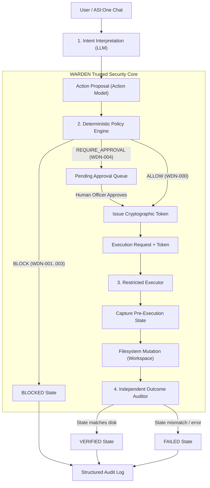
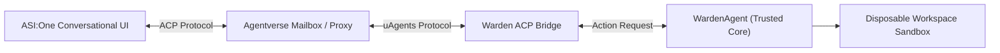

# WARDEN — System Architecture Specification

## 1. System Overview & Core Philosophy

WARDEN is an autonomous action-verification system engineered for AI agent ecosystems. It addresses a fundamental flaw in modern autonomous agent architectures: **agents currently execute critical tools simply because an LLM emitted an instruction.**

WARDEN decouples probabilistic reasoning from deterministic execution. LLMs are treated as **untrusted proposal engines**. No action can affect the filesystem or external environment without passing through a four-stage verification pipeline:

---

## 2. Trust Boundaries & Separation of Concerns

WARDEN strictly enforces security boundaries across three distinct operational planes:

| Boundary | Components | Trust Level | Responsibility |
|---|---|---|---|
| **Untrusted Plane** | External users, prompt inputs, LLMs (e.g., ASI1-mini), file content | **Untrusted** | Generates suggestions, natural language responses, and tentative action plans. Cannot directly invoke execution primitives. |
| **Enforcement Plane** | `PolicyEngine`, `PathValidator`, `AuthorizationManager` | **Trusted Core** | Evaluates policies deterministically, validates workspace containment, and signs cryptographic authorization tokens. |
| **Execution & Audit Plane** | `RestrictedExecutor`, `Workspace`, `OutcomeAuditor`, `AuditLogger` | **Isolated Sandboxing** | Enforces token validity, performs OS-level actions within a disposable directory sandbox, independently checks disk state, and produces immutable audit records. |

### The "Never Self-Authorize" Invariant
An LLM or untrusted agent **cannot authorize its own actions**. An authorization token must be signed using an internal secret key managed solely by `AuthorizationManager`. If an attacker attempts to pass fabricated JSON claiming `ALLOW`, the cryptographic verification fails, and the executor rejects the request immediately.

---

## 3. Four-Stage Lifecycle Pipeline

### Stage 1: Proposal (`PROPOSED`)
- The incoming request is mapped into a strongly-typed `Action` model:
  - `operation`: One of `READ`, `CREATE`, `WRITE`, `DELETE`, `RENAME`.
  - `target`: Relative target path.
  - `destination`: Optional relative destination path (mandatory for `RENAME`).
  - `content`: Optional proposed payload.
  - `reason`: Justification provided by agent/user.
  - `action_id`, `correlation_id`, `timestamp`.
- Initial audit event recorded with status `PROPOSED`.

### Stage 2: Deterministic Authorization (`AUTHORIZED` / `BLOCKED` / `AWAITING_APPROVAL`)
- Evaluated by `PolicyEngine` and `PathValidator`:
  - **Supported operations check:** Unknown commands (e.g. `EXECUTE_SHELL`) are rejected with `WDN-001`.
  - **Path boundary containment:** Canonical path resolution enforces strict containment within `workspace_root`. Directory traversal (`..`), Windows drive letters (`C:`), UNC paths (`\\server\share`), device names (`CON`, `NUL`), Alternate Data Streams (`:`), and symlink breakouts are rejected with `WDN-002`.
  - **Protected resources:** Sensitive configuration files (`.env`, `production.env`, `secrets.json`, `credentials.json`) cannot be read, written, created, deleted, or renamed (`WDN-003`); a read result goes back to a remote chat peer, so reading one would leak it.
  - **Destructive operations:** Deletions and renames trigger `REQUIRE_APPROVAL` (`WDN-004`).
- If `ALLOW`: An unforgeable `AuthorizationToken` (HMAC-SHA256) is issued with an explicit expiration window.
- If `REQUIRE_APPROVAL`: The action is placed into a pending approval state. Ordinary LLM statements cannot approve the action; approval must come through a trusted verification channel (`approve_and_execute`).

### Stage 3: Controlled Execution (`EXECUTED` / `FAILED`)
- The `RestrictedExecutor` operates inside an isolated `Workspace`.
- Execution prerequisites:
  1. Action operation is supported.
  2. Target and destination pass canonical path validation.
  3. Resources do not collide with protected definitions.
  4. Authorization token is valid, unexpired, matches action and workspace parameters, and carries a valid signature.
- Operations are executed using safe Python primitives. Ordinary filesystem errors fail closed and return `FAILED`.

### Stage 4: Independent Outcome Verification (`VERIFIED` / `FAILED`)
- Handled by `OutcomeAuditor`, completely independent of the executor.
- Rather than trusting the executor's return status:
  - **CREATE / WRITE:** Verifies target exists, is a regular file, and content matches requested content via SHA-256 hash inspection.
  - **DELETE:** Verifies target no longer exists on disk.
  - **RENAME:** Verifies source path is gone and destination path exists with expected content.
- Prevents false success reporting or partial execution anomalies.

---

## 4. Planned Fetch.ai Ecosystem Integration

The foundation prepared in Phase 0 interfaces directly with the Fetch.ai stack:

1. **uAgents & Agentverse Registration:**
   - WARDEN agent will be registered on Agentverse with an Agent Profile and Mailbox.
2. **Agent Chat Protocol (ACP):**
   - Implemented via `ChatMessage`, `ChatResponse`, and interactive `ActionCard` models in `src/warden/integrations/fetch_acp.py`.
3. **ASI Interactive Cards:**
   - Destructive operations requiring human approval (`REQUIRE_APPROVAL`) render as interactive approval cards in the ASI:One chat, enabling the user to approve or reject actions directly.
